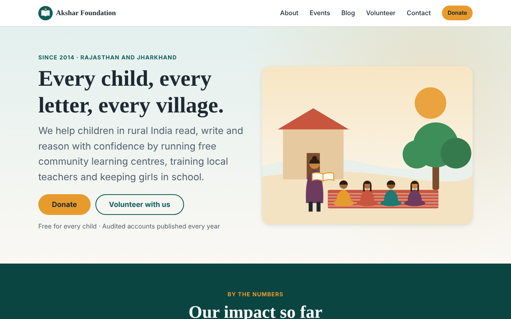
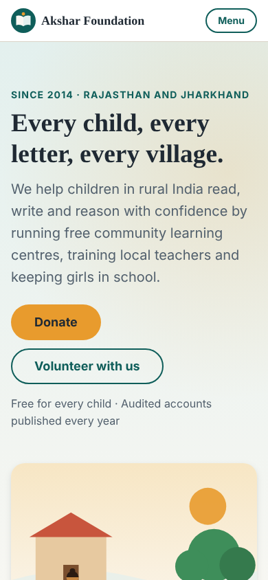
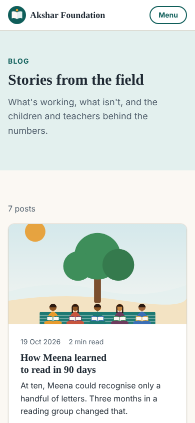
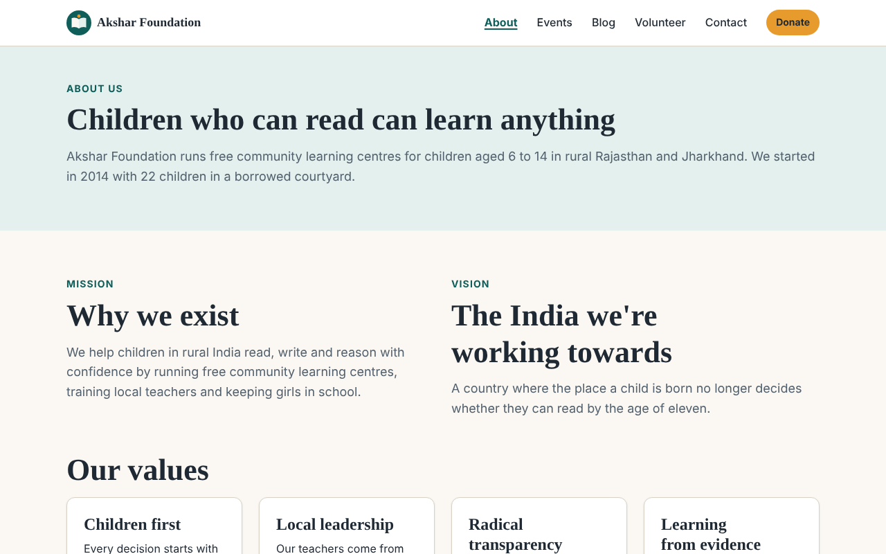
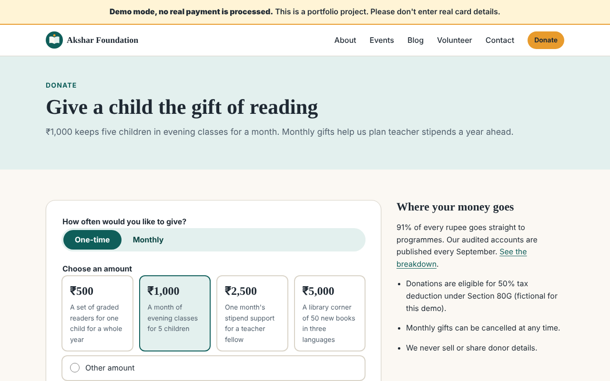
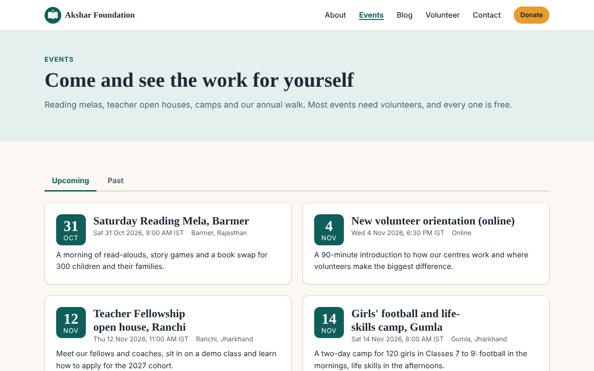
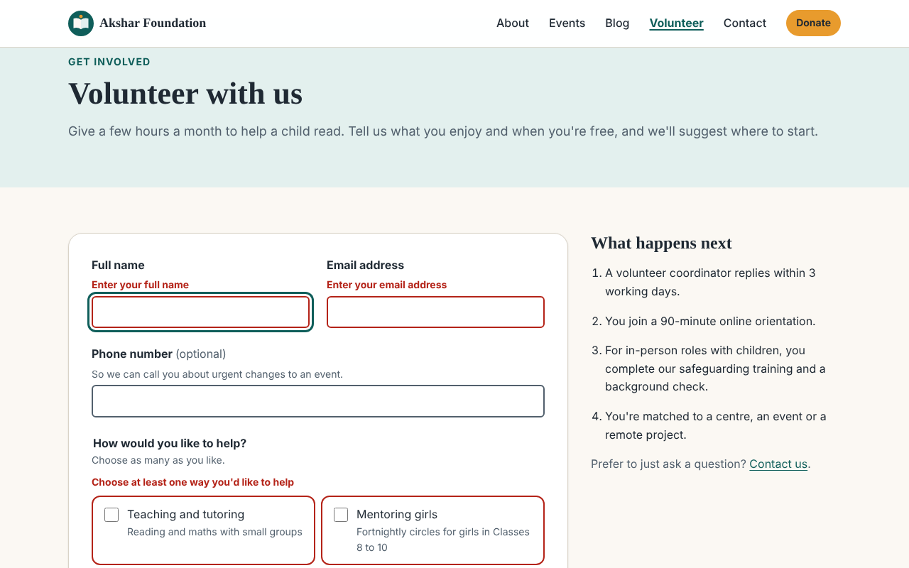
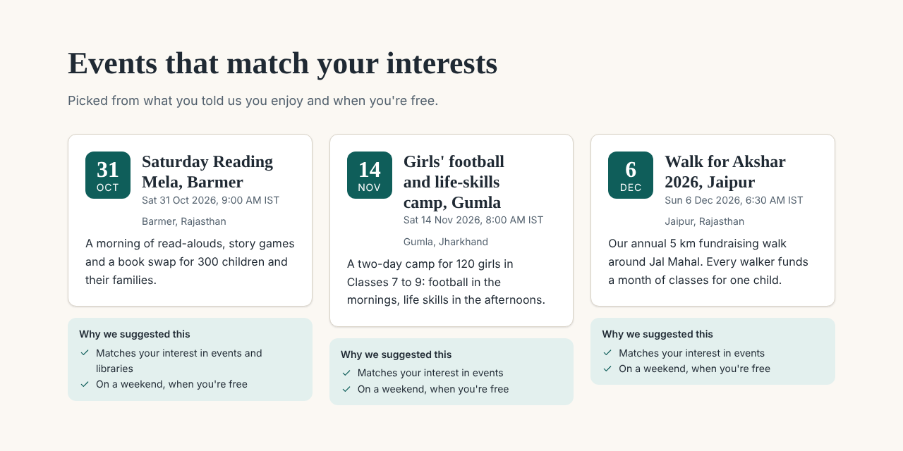
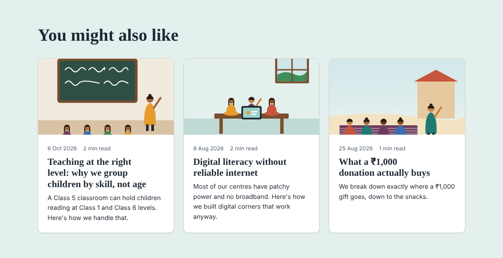
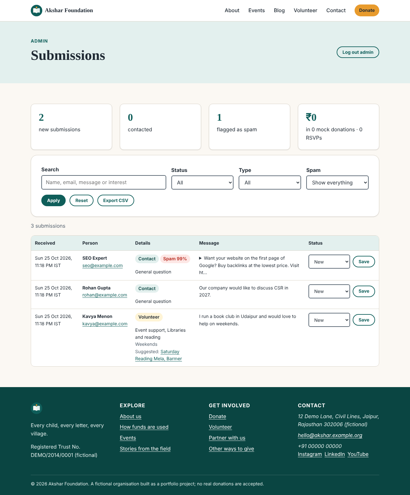

# Akshar Foundation

**Every child, every letter, every village.**

A complete website for a fictional NGO that runs free learning centres for children in rural
Rajasthan and Jharkhand. It is server-rendered Python (FastAPI, Jinja2, SQLite) with
hand-written CSS, a little vanilla JavaScript and three small, offline ML features.

> **This is a portfolio project.** The organisation, people, numbers, addresses and bank
> details are invented. The donate flow uses a mock payment provider: no real money moves,
> and no card data is collected or stored.



## Contents

- [What's inside](#whats-inside)
- [Screenshots](#screenshots)
- [Run it](#run-it)
- [Architecture](#architecture)
- [Design decisions](#design-decisions)
- [What's mocked and what's real](#whats-mocked-and-whats-real)
- [ML notes](#ml-notes)
- [Assumptions](#assumptions)
- [Future improvements](#future-improvements)

## What's inside

| Page | What it does |
| --- | --- |
| `/` | Mission, impact numbers, programmes, upcoming events, latest stories |
| `/about` | Mission, vision, values, approach, milestones, team and how funds are used |
| `/donate` | Preset and custom amounts, one-time or monthly, a mock checkout and a receipt page and email |
| `/volunteer`, `/contact` | Working forms: validation, CSRF, honeypot, rate limiting, confirmation emails, spam scoring |
| `/events`, `/events/<slug>` | Upcoming and past events, RSVP form, add-to-calendar (`.ics`) |
| `/blog`, `/blog/<slug>` | Paginated stories with tag filters, reading time and related posts |
| `/admin` | Password-protected: search, filter and update submissions, export CSV |
| `/styleguide` | The design system: colours, type, buttons, form states, cards |

The site also has `sitemap.xml`, `robots.txt`, Open Graph tags, a social preview image and
custom 404 and 500 pages.

The three ML features:

1. **Related posts.** TF-IDF and cosine similarity suggest "You might also like" posts.
2. **Volunteer-to-event matching.** After someone signs up, the thank-you page suggests
   upcoming events and gives the reason for each one.
3. **Spam scoring.** A small classifier scores every form submission. Likely spam is kept
   but hidden from the admin's default view, and it gets no confirmation email.

## Screenshots

| | |
| --- | --- |
|  |  |
| Homepage, 390 px wide | Blog, 390 px wide |









To regenerate them, run `make screenshots`. It starts its own server on a throwaway
database. It needs the optional Playwright package and a Chromium build:
`.venv/bin/playwright install chromium`, once.

## Run it

You need Python 3.11 or newer and `make`.

```bash
make run
```

On a fresh clone, `make run` does the following before it starts the server:

1. Creates `.venv` and installs the pinned dependencies.
2. Writes a local `.env` with a random `SECRET_KEY` and a random admin password. The
   password is **printed once**, so copy it.
3. Generates the synthetic spam dataset and trains the model. This takes about two seconds.
4. Seeds 9 events and 7 blog posts.

Then open <http://127.0.0.1:8000>. The admin is at `/admin`, with username `admin`.

| Command | What it does |
| --- | --- |
| `make run` | Set up everything, then start the site with auto-reload |
| `make test` | Run the test suite (265 tests, about 6 seconds) |
| `make lint` | Run `ruff check` and `ruff format --check` |
| `make format` | Auto-format and apply lint fixes |
| `make seed` / `make reseed` | Seed demo content, or wipe the database and seed again |
| `make train` | Regenerate the synthetic data and retrain the spam model |
| `make admin-password` | Print a bcrypt hash for a new admin password |
| `make screenshots` | Recapture the README screenshots and the social card |
| `make clean` | Remove caches, the database and generated ML files (keeps `.env`) |

**Configuration.** Everything comes from environment variables or `.env`; see
[`.env.example`](.env.example) for the full list. Nothing secret is hardcoded. With
`APP_ENV=production`, the app refuses to start without a `SECRET_KEY`, and it turns on
secure cookies and HSTS.

**Email.** By default, emails are written as `.eml` files to `outbox/`, which you can open
in any mail client. Set `EMAIL_BACKEND=console` to log them instead, or `smtp` (with the
`SMTP_*` variables) to send them for real.

**Rebranding.** The name, tagline, mission, contact details and colours all live in
`BRAND` in [`app/config.py`](app/config.py). A test checks that every text colour pair
still meets WCAG AA contrast after a change.

## Architecture

```
app/
  main.py          App factory: settings, middleware, routers, and which ML features are on
  config.py        BRAND (identity) and Settings (environment and secrets)
  routes/          Thin HTTP layer: parse the request, call a service, render a template
  services/        Business logic: content queries, submissions, donations, email, admin
  ml/              Pure ML code with no web or database imports, so it unit-tests easily
  models.py        SQLAlchemy models   schemas.py   Pydantic form validation
  security.py      CSP and headers, CSRF, form nonces, rate limiter, honeypot
  seed.py, seed_data.py, content.py   Demo content
templates/         base.html, partials/, macros/ (forms, cards, icons, ui), pages/, emails/
static/            css/main.css (the design system), js/ (3 small files), img/
scripts/           create_env, hash_password, generate_spam_data, train_spam, screenshots
tests/             unit/ and integration/ (pytest and TestClient)
```

**A form POST, step by step** ([`app/routes/forms.py`](app/routes/forms.py)), cheapest
check first:

```
CSRF token + Origin check -> rate limit -> honeypot -> one-time form token -> validate
  -> spam score -> save -> confirmation email (background task, skipped for spam)
  -> 303 redirect to /thanks (Post/Redirect/GET, so refreshing never resubmits)
```

**Swappable parts.** Email (`EmailService`) and payments (`PaymentProvider`) are abstract
base classes. The app picks an implementation in one place (`create_app`), and tests use
in-memory versions. The ML features are plain callables on `app.state`, and each one
falls back to a simple non-ML version when its flag is off.

**Testing.** Each test gets its own app, SQLite file and in-memory mail outbox. The
integration tests drive the real HTML forms through `TestClient`: they fetch the CSRF and
form tokens from the page, then post them back, just as a browser would.

## Design decisions

- **Server-rendered HTML, not a single-page app.** Every page works without JavaScript.
  JavaScript only adds client-side validation, the mobile menu, the donate amount picker and
  a double-submit guard. It is fast on cheap phones, easy to index, and has no build step.
- **Hand-written CSS rather than the Tailwind CDN.** The CDN would need a third-party
  script and a looser Content Security Policy. One stylesheet built on design tokens is
  about 1,600 lines, and it is all used.
- **Strict CSP with no `unsafe-inline`.** There are no inline scripts or styles. Brand
  colours are served from `/brand.css`, which is generated from `BRAND`, so a colour
  change never means relaxing the policy.
- **Accessibility, built in from the start.** The site has:
  - a skip link and visible focus rings
  - error messages linked to their fields with `aria-describedby`
  - an error summary that receives focus after a failed submit
  - `aria-current` on the active nav item, and labelled landmarks
  - `prefers-reduced-motion` support
  - colours that are contrast-checked in a test
- **Security basics:**
  - parameterised queries everywhere (SQLAlchemy)
  - Markdown sanitised with `nh3` after rendering
  - Jinja autoescaping
  - bcrypt for the admin password, checked against a dummy hash when the username is
    wrong, so response times don't reveal valid usernames
  - the session renewed on login
  - CSV export protected against formula injection
  - admin pages marked `no-store` and `noindex`
  - visitor IPs stored only as a keyed hash
- **Idempotent forms.** Every form carries a one-time token, so a double-click or a
  replayed POST is saved once. Donations also pass an idempotency key to the payment
  provider.
- **Money as integer paise.** Floats are never used for currency.
- **UTC in the database, IST on the page.** India has no daylight saving, so a fixed
  offset is exact.

## What's mocked and what's real

| Area | Status |
| --- | --- |
| Volunteer and contact forms | **Real.** Validated, stored in SQLite, emailed, and visible in admin. |
| Event RSVPs and `.ics` downloads | **Real.** Capacity is enforced and duplicate emails are rejected. |
| Admin login, filters, status updates, CSV export | **Real.** |
| Emails | **Real templates.** They go to `.eml` files by default and over SMTP if you configure it. |
| Payments | **Mocked.** `MockPaymentProvider` approves every amount except ₹1,313, which always declines so you can see the failure path. The demo card fields have no `name` attribute, so the browser never submits them; a test checks this. |
| Bank transfer and UPI details | **Fake.** IFSC `DEMO0000001`, UPI `akshar.demo@example`. |
| Monthly donations | **Recorded only.** The frequency is saved and shown on the receipt; no recurring billing is simulated. |
| Organisation, people, numbers, stories | **Fictional.** |
| ML features | **Real code on synthetic data.** See below. |

## ML notes

All three features run offline with scikit-learn, live in `app/ml/` (with no web or
database code), sit behind a flag in `.env`, and have a non-ML fallback.

### 1. Related posts

- **Method.** TF-IDF over each post's title, tags and body; titles and tags are repeated
  so they count for more. Then cosine similarity. Bigrams and sublinear term frequency are
  on, and English stop words are removed. Scores under 0.05 are dropped. The model refits
  only when the set of published posts changes.
- **Why.** With 7 posts and no reading history, a content-based method is the only honest
  option. It is instant and explainable.
- **Limits.** It matches words, not meaning: "girls' education" and "keeping daughters in
  school" only match through words they share. Edits to a post's body don't trigger a
  refit until the next restart.
- **Fallback.** Posts that share the most tags.

### 2. Volunteer-to-event matching

- **Method.** A transparent rule, not a trained model:
  `score = 0.7 × Jaccard(volunteer interests, event tags) + 0.3 × availability fit`.
  An event must share at least one interest to be suggested, and each suggestion lists
  its reasons. Ties go to the sooner event.
- **Why.** There is no history of which volunteers enjoyed which events, so anything
  "learned" would be learned from nothing. The weights are a starting point. Once RSVP and
  attendance data exist, a simple learned ranker would replace them.
- **Limits.** The interest and availability vocabularies are fixed, and location is
  ignored.
- **Fallback.** The next three upcoming events.

### 3. Spam scoring

**Data.** The data is synthetic, and it is the most important caveat here.
[`app/ml/spam_data.py`](app/ml/spam_data.py) fills 25 genuine and 21 spam sentence
templates with random names, cities, amounts and links, giving 1,200 balanced samples.
Real spam is more varied and changes over time to get past filters. The templates include
hard cases on purpose:

- genuine messages with links, prices, phone numbers, acronyms and the word "free"
- spam with no links at all
- Hinglish on both sides

**Method.** Logistic regression on word 1–2-gram TF-IDF plus character 3–5-gram TF-IDF.
Character n-grams catch obfuscation like "fr33", and link fragments like `http` and
`.xyz`. The classifier sees the name and the message together.

**Evaluation.** Grouped 4-fold cross-validation by template: every sample is scored by a
model that never saw any sentence from its template. A random split would put
near-duplicate sentences in both train and test, and report a meaningless perfect score.

| Threshold | Precision | Recall |
| --- | --- | --- |
| 0.50 | 1.00 | 0.90 |
| **0.65 (in use)** | **1.00** | **0.82** |
| 0.80 | 1.00 | 0.72 |
| 0.90 | 1.00 | 0.59 |

ROC AUC is 0.999. The spam templates it misses most often when it hasn't seen them are
the inheritance scam (missed 100% of the time), the fake-reviews offer (100%) and Hinglish
offers (76%). These are spam without links, prices or the usual vocabulary.

**The threshold favours precision.** A false positive hides a real volunteer's message,
while a false negative only means one spam message to delete by hand. 0.65 keeps
precision at 1.0 on unseen templates with some margin above 0.5. You can change it with
`SPAM_THRESHOLD`.

**What changed during development.** The first version also used hand-made text
statistics: the share of capital letters, the share of digits, and message length. While
taking these screenshots, the model flagged "Our company would like to discuss CSR in
2027." as 91% spam. That message has a capitalised name, an acronym and a year: the
features had learned how my templates were written, not what spam is. Grouped
cross-validation confirmed it.

| Features | Precision at the threshold | ROC AUC |
| --- | --- | --- |
| TF-IDF only (in use) | 1.00 | 0.999 |
| TF-IDF plus text statistics | 0.87 | 0.92 |

The statistics now ship switched off, and `make train` prints both variants so the choice
can be rechecked. Hand-written sanity messages that never go into training are printed at
the end of training and asserted in the tests. They were written while fixing this, so they
are a development check, not an unbiased test.

**Limitations:**

- The numbers describe how well the model separates *my templates*. On real traffic they
  would be lower.
- The model is English and Hinglish only, and short messages give it little to go on.
- Joblib files are pickles, so only load a model this project's own training script
  wrote.
- Retraining needs real, labelled submissions. The admin's spam filter view is where those
  labels would come from.

**Safety.** The model only flags submissions; nothing is deleted. It sits behind the
honeypot and rate limiter. If the model file is missing or fails to load, every submission
is accepted and the app logs a warning.

## Assumptions

Where the brief left something open, I chose the following:

- **The organisation.** "Akshar Foundation" (*akshar* means "letter" in Hindi), working on
  child literacy in rural Rajasthan and Jharkhand. All its details are fictional and
  labelled as such.
- **One admin account**, configured through environment variables (a bcrypt hash). There
  is no user table or roles.
- **Receipts** can be viewed only from the browser session that made the donation (there
  are no donor accounts). A copy is also emailed.
- **Rate limiting** is in-memory and per process: 8 form posts per IP per 10 minutes,
  shared across the public forms, plus a separate limit for admin logins. That is right
  for one process; several workers would need a shared store such as Redis.
- **Honeypot hits** get the normal success page, so bots learn nothing, but nothing is
  stored or sent.
- **Likely spam** is saved but hidden, rather than rejected, so a false positive is
  recoverable.
- **Donation limits** are ₹100 to ₹5,00,000. Preset amounts are ₹500, ₹1,000, ₹2,500 and
  ₹5,000.
- **Seeded event dates** are relative to the day you seed, so there are always upcoming
  and past events.
- **Database tables** are created at startup and there are no migrations. A real
  deployment would add Alembic.

## Future improvements

- **Payments:** a real hosted checkout (Razorpay or Stripe Checkout) behind
  `PaymentProvider`. The card form would live on the provider's domain, and a webhook
  would confirm payment. Add 80G tax receipts as PDFs.
- **Spam:**
  - retrain on real labelled submissions, with a "not spam" button in admin to collect
    labels
  - track precision over time
  - calibrate the probabilities
- **Related posts:** sentence embeddings (a small offline model) for meaning rather than
  shared words, once there are enough posts for it to matter.
- **Matching:** learn the weights from RSVP and attendance data, and add location.
- **Operations:**
  - Postgres and Alembic
  - a Redis-backed rate limiter
  - structured logging and error tracking
  - a Dockerfile, and CI running `make lint test`
- **Content:** a small CMS or Markdown files in git for posts and events, instead of seed
  data.
- **Languages:** Hindi alongside English.
